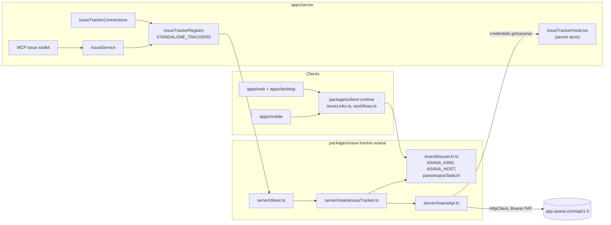
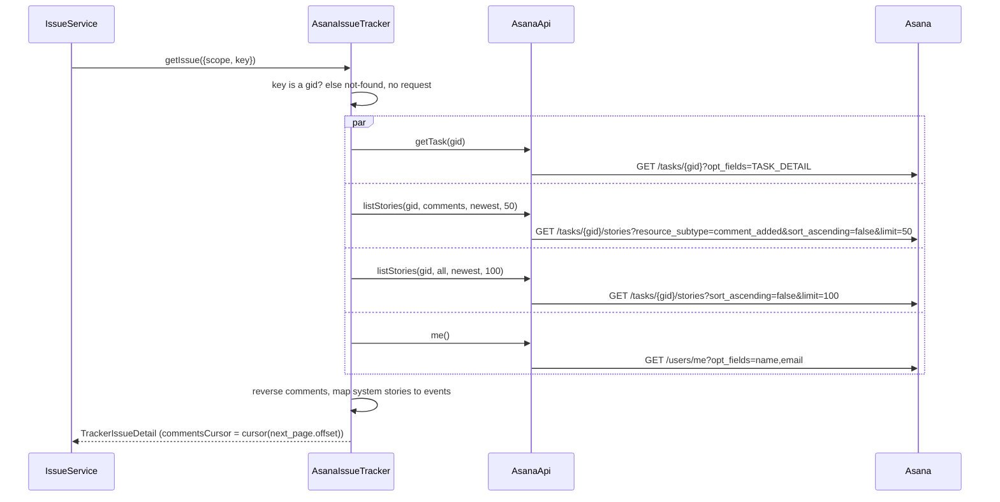
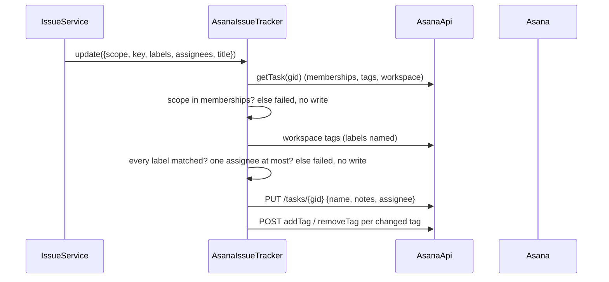

# Design Document: Asana issue tracker

## Overview

This design adds `packages/issue-tracker-asana`, a standalone issue tracker that implements the existing `StandaloneIssueTrackerApi` port (`packages/source-control-core/src/server/IssueTracker.ts`) over Asana's REST API, and registers it beside Linear. The server services that already serve Linear (`IssueTrackerConnections`, `IssueTrackerHostLive`, `IssueService`, the MCP issue toolkit) serve Asana unchanged. The client changes are small tables (icon, mark, name), one link parser call, and two `#`-prefix rules that assumed only git hosts number their issues.

The work is one problem in the sense of upstream `CONTRIBUTING.md` ("One problem per PR"): Asana as an issue tracker. It touches no contract schema, refactors nothing outside the files Appendix A of `requirements.md` names, and ships as one draft PR in `jvansan/t3code`.

### Design decisions

| Decision                        | Choice                                                                                                                       | Why                                                                                                                                                                                                                                                                                                                                                                                                                              |
| ------------------------------- | ---------------------------------------------------------------------------------------------------------------------------- | -------------------------------------------------------------------------------------------------------------------------------------------------------------------------------------------------------------------------------------------------------------------------------------------------------------------------------------------------------------------------------------------------------------------------------- |
| HTTP client                     | A hand-written client over `effect/http` `HttpClient`, with one `request` function and Effect `Schema` decoders per resource | Asana is REST. Asana's own Node SDK would add a dependency, its own retry loop (Requirement 13.4 forbids retries), and untyped responses.                                                                                                                                                                                                                                                                                        |
| Issue scope                     | The Asana project gid                                                                                                        | It is what the probe lists, what task URLs name, and what `POST /tasks` takes in `projects`.                                                                                                                                                                                                                                                                                                                                     |
| Issue key and Display_Key       | The task gid (Appendix C, Q3)                                                                                                | Asana has no short key on every plan. A peer session reported an `Eng. ID` custom field on the owner's tasks; it is a candidate Display_Key for later and is not implemented.                                                                                                                                                                                                                                                    |
| Workspace identity (Q1)         | The constant `app.asana.com` (`ASANA_HOST`) from both `parseIssueUrl` and `probeCredential`                                  | Legacy links name no workspace, gids are globally unique, and both resolvers compare `workspace` strings. The constant makes every Asana link match every Asana account, and the server's canonical-URL check still proves the account can read the task. Settings shows the value under the account (`IssueTrackerSettings.tsx` line 175, `IssueTrackerSection.tsx` line 106); the host reads better there than an opaque word. |
| Links that name no project (Q2) | Scope `0`, the value Asana's own legacy form uses                                                                            | No Asana project has gid `0`, so the scope matches no Bound_Project, and `IssueService.resolveUrl` and `issueLinks.ts` serve the task read-only through a lender project with no change.                                                                                                                                                                                                                                         |
| Newest comments (Q7)            | `GET /tasks/{gid}/stories?resource_subtype=comment_added&sort_ascending=false&limit=50`, reversed per page                   | Both parameters are documented ([Get stories from a task](https://developers.asana.com/reference/getstoriesfortask)). The newest page costs one request whatever the history length, and `next_page.offset` leads to older comments.                                                                                                                                                                                             |
| Events                          | `GET /tasks/{gid}/stories?sort_ascending=false&limit=100`, keeping system stories                                            | One request, bounded to the 100 newest stories (Requirement 8.8).                                                                                                                                                                                                                                                                                                                                                                |
| User login (Q5)                 | Email when Asana returns it, else gid                                                                                        | Asana's `assignee` field accepts either (`TaskRequestBase.assignee` in the [Asana OpenAPI spec](https://raw.githubusercontent.com/Asana/openapi/master/defs/asana_oas.yaml)), so a write needs no lookup.                                                                                                                                                                                                                        |
| Tag colours                     | A fixed table from Asana's 18 named colours to hex                                                                           | The clients draw a label dot only for a 6-digit hex (`pullRequestLabelColor` in web and mobile); Asana returns names such as `dark-pink`.                                                                                                                                                                                                                                                                                        |
| `#` prefix                      | Prefix `#` only for git-host trackers (`sourceControlClients.find(tracker) !== undefined`)                                   | Generic: it fixes Asana and any later standalone tracker with numeric keys without naming Asana in UI code.                                                                                                                                                                                                                                                                                                                      |

### Research findings

Sources checked on 2026-11-25. `requirements.md` Appendix B now carries the corrected list.

- Auth and base URL: `Authorization: Bearer <PAT>` against `https://app.asana.com/api/1.0` ([Personal access token](https://developers.asana.com/docs/personal-access-token), [Quick start](https://developers.asana.com/docs/quick-start)). PATs are minted at `https://app.asana.com/0/my-apps` ([Manage your app](https://developers.asana.com/docs/manage-and-share-your-app)). Asana says to treat token formats as opaque, so the client never validates a PAT's shape.
- Envelope and paging: `{ data, next_page: { offset, path, uri } | null }`, `limit` 1 to 100, offset tokens that expire ([Pagination](https://developers.asana.com/docs/pagination)).
- `opt_fields` is a comma-separated list of dotted paths on GET; on POST and PUT with a JSON body, options go in a top-level `options: { fields: [...] }` beside `data` ([Input/output options](https://developers.asana.com/docs/inputoutput-options)).
- Rate limits: HTTP 429 with `Retry-After` in seconds from every limiter; 150 requests a minute per token on free domains and 1,500 on paid; 50 concurrent GETs and 15 concurrent writes; a cost limit on large graph traversals, which lean `opt_fields` and `limit=100` reduce ([Rate limits](https://developers.asana.com/docs/rate-limits)).
- Search: premium only, HTTP 402 otherwise ([Search tasks in a workspace](https://developers.asana.com/reference/searchtasksforworkspace)).
- Project tasks: `GET /projects/{gid}/tasks` takes `completed_since`, `limit`, `offset`, and `opt_fields`, and returns tasks in the project's priority order. No sort, assignee, or completed-only filter exists. `GET /tasks` allows `assignee` only with `workspace`, not with `project` (OpenAPI `getTasks`).
- Writes: `POST /tasks` takes `projects` and `tags` as create-only arrays; `PUT /tasks/{gid}` takes `name`, `notes`, `assignee`, `completed`; `POST /tasks/{gid}/addTag` and `removeTag` take `{ tag }` (OpenAPI `TaskCreateRequest`, `TaskRequestBase`, `TaskAddTagRequest`).
- Story subtypes and their fields: `marked_complete`, `marked_incomplete`, `assigned` (`assignee`), `unassigned` (no user), `name_changed` (`old_name`, `new_name`), `added_to_tag` and `removed_from_tag` (`tag`) ([forum: new fields on stories](https://forum.asana.com/t/no-more-parsing-story-text-new-fields-on-stories/42924)).
- Tag colour is one of 18 names or null (OpenAPI `TagBase.color`).
- Task URLs: V0 `/0/<project>/<task>[/f]`, `/0/0/<task>`; V1 `/1/<workspace>/project/<project>/task/<task>` and `/1/<workspace>/task/<task>`; V1 focus mode is `?focus=true`; V0 links stay supported indefinitely ([forum: V1 URL format](https://forum.asana.com/t/upcoming-new-v1-asana-url-format-in-the-browser/1011489)). `permalink_url` follows V1: the OpenAPI `TaskResponse` example is `https://app.asana.com/1/12345/task/123456789`, and a peer session with a live PAT reported the `/project/` form.
- Project members: the project `members` field lists users; Asana's forum warns that teams added to a project do not appear in it ([forum: changes to stories](https://forum.asana.com/t/change-upcoming-changes-to-stories/727582/2)).

Content was rephrased for compliance with licensing restrictions.

## Architecture



The package follows the Linear package's split:

- `shared/issueUrl.ts` imports only `@t3tools/contracts`, so web and mobile bundle it through `packages/client-runtime` (Requirement 1.5).
- `server/AsanaApi.ts` is the only module that sends HTTP. It reads the PAT from `IssueTrackerHost` per call, maps every failure to `IssueTrackerError`, and decodes every body with `Schema`.
- `server/AsanaIssueTracker.ts` is pure mapping and orchestration over `AsanaApi`: filters, cursors, guards, and Asana resources to contract types.
- `server/driver.ts` provides `AsanaApi.make` to the tracker, so `make` needs only `HttpClient` and `IssueTrackerHost` (Requirement 1.2).

### Request flows



A detail costs four concurrent GETs, well under Asana's 50-GET concurrency limit, and the cost does not grow with the task's history. An older-comments page costs one GET.



Every check that can refuse a write runs before the first write (Requirements 10.3, 10.5, 10.11, 10.12).

### Server registration

`apps/server/src/issue/IssueTrackerRegistry.ts`:

```ts
import * as AsanaDriver from "@t3tools/issue-tracker-asana/server/driver";
const STANDALONE_TRACKERS = [LinearDriver.make, AsanaDriver.make];
```

`IssueTrackerRegistry.layer` already provides `IssueTrackerHostLive.layer`; `HttpClient` comes from the server runtime as it does for Linear. No other server file changes (Requirement 15.4).

### Link resolution without server changes

`IssueService.resolveUrl` (lines 783 to 891) and `resolveStandaloneIssueLink` in `packages/client-runtime/src/issueLinks.ts` both:

1. parse the URL with the tracker's parser,
2. keep accounts whose connection `workspace` equals the link's `workspace` (client) or whose canonical issue URL parses to the link's `workspace` (server),
3. prefer a project bound to the link's scope, else lend any project bound to the tracker, read-only.

With the constant workspace identity, step 2 passes for every Asana account that can read the task; the server's step 2 still reads the task through each account in preference order and keeps the first that answers, so an account that cannot see the task falls through to `not-found` (Requirement 5.5). Step 3 does the rest: a project-form link whose project is bound opens writable; a project-less link (scope `0`) or a link to an unbound project opens read-only (Requirement 5.6). Requirement 5.4 holds because V0 and V1 project-form links to one task parse to the same `{ host, scope, key }`.

The only client change is in `issueLinks.ts`:

```ts
function parseStandaloneIssueLink(url: string) {
  try {
    const parsed = new URL(url);
    const linear = parseLinearIssueUrl(parsed);
    if (linear !== null) return { tracker: LINEAR_KIND, link: linear };
    const asana = parseAsanaTaskUrl(parsed);
    return asana === null ? null : { tracker: ASANA_KIND, link: asana };
  } catch {
    return null;
  }
}

export function mayContainStandaloneIssueLink(text: string): boolean {
  return text.includes(`${LINEAR_HOST}/`) || text.includes(`${ASANA_HOST}/`);
}
```

## Components and Interfaces

### `packages/issue-tracker-asana/package.json`

```json
{
  "name": "@t3tools/issue-tracker-asana",
  "private": true,
  "type": "module",
  "exports": {
    "./shared/issueUrl": {
      "types": "./src/shared/issueUrl.ts",
      "import": "./src/shared/issueUrl.ts"
    },
    "./server/driver": { "types": "./src/server/driver.ts", "import": "./src/server/driver.ts" }
  },
  "scripts": {
    "typecheck": "effect-tsgo tsrs --noEmit",
    "test": "vp test run --config ../../vite.config.ts --dir ."
  },
  "dependencies": {
    "@t3tools/contracts": "workspace:*",
    "@t3tools/source-control-core": "workspace:*",
    "effect": "catalog:"
  },
  "devDependencies": {
    "@effect/vitest": "catalog:",
    "@types/node": "catalog:",
    "vite-plus": "catalog:"
  }
}
```

The Linear manifest's `generate` script and `@effect/graphql-generator` dev dependency have no counterpart. `tsconfig.json` is a copy of the Linear one.

### `src/shared/issueUrl.ts`

```ts
export const ASANA_KIND = IssueTrackerKind.make("asana");
export const ASANA_HOST = "app.asana.com";
/** What every Asana link and account report as their workspace (see design Q1). */
export const ASANA_WORKSPACE = ASANA_HOST;
/** The scope of a link that names no project; no Asana project has gid 0. */
export const ASANA_NO_PROJECT = "0";

export function parseAsanaTaskUrl(
  url: URL,
): { host: string; workspace: string; scope: string; key: string } | null;
```

Parsing rules, in order (Requirement 4):

1. Reject unless `url.protocol === "https:"`, `url.hostname === "app.asana.com"` (the URL parser lowercases it), and `url.username`, `url.password`, and `url.port` are all empty.
2. Split `url.pathname` on `/`, drop the leading empty segment and one trailing empty segment. Query and fragment are never read.
3. Match the segments against these forms, where `G` is `/^\d{1,32}$/`:

| Segments                             | Scope | Key |
| ------------------------------------ | ----- | --- |
| `0, G(p), G(t)`                      | `p`   | `t` |
| `0, G(p), G(t), f`                   | `p`   | `t` |
| `1, G(w), project, G(p), task, G(t)` | `p`   | `t` |
| `1, G(w), task, G(t)`                | `0`   | `t` |

The V0 row with `p = "0"` is the project-less legacy form and yields scope `0` naturally. Anything else returns null, including V1 comment and Home links (Appendix B lists them as not accepted).

4. Return `{ host: ASANA_HOST, workspace: ASANA_WORKSPACE, scope, key }`.

The V1 workspace gid is validated and discarded: the link identity does not depend on it (Q1).

### `src/server/AsanaApi.ts`

```ts
export const KIND = ASANA_KIND;
const DEFAULT_API_URL = "https://app.asana.com/api/1.0";
const AsanaApiConfig = Config.all({
  apiUrl: Config.String("T3CODE_ASANA_API_URL").pipe(Config.withDefault(DEFAULT_API_URL)),
});

export class AsanaApi extends Context.Service<AsanaApi, {
  /** The token's user and workspaces. Takes a token so it can vet a new one. */
  readonly me: (token?: string) => Effect.Effect<AsanaMe, IssueTrackerError>;
  /** Every live project of a workspace, following each offset. */
  readonly listProjects: (workspaceGid: string, token?: string) =>
    Effect.Effect<ReadonlyArray<AsanaProjectRef>, IssueTrackerError>;
  /** Null for a project Asana has not, or this token cannot see. */
  readonly getProject: (gid: string) => Effect.Effect<AsanaProject | null, IssueTrackerError>;
  readonly listProjectTasks: (input: {
    readonly projectGid: string;
    readonly incompleteOnly: boolean;
    readonly withFollowers: boolean;
    readonly limit: number;
    readonly offset?: string | undefined;
  }) => Effect.Effect<AsanaPage<AsanaTask>, IssueTrackerError>;
  /** Null for a task Asana has not, or this token cannot see. */
  readonly getTask: (gid: string, fields: "detail" | "link" | "guard") =>
    Effect.Effect<AsanaTask | null, IssueTrackerError>;
  readonly listStories: (input: {
    readonly taskGid: string;
    readonly commentsOnly: boolean;
    readonly limit: number;
    readonly offset?: string | undefined;
  }) => Effect.Effect<AsanaPage<AsanaStory>, IssueTrackerError>;
  /** Up to `maxPages` pages of 100; `truncated` when Asana had more. */
  readonly listWorkspaceTags: (workspaceGid: string, maxPages: number) =>
    Effect.Effect<{ readonly tags: ReadonlyArray<AsanaTag>; readonly truncated: boolean }, IssueTrackerError>;
  readonly createTask: (input: {
    readonly projectGid: string;
    readonly name: string;
    readonly notes: string;
    readonly tagGids: ReadonlyArray<string>;
    readonly assignee: string | null;
  }) => Effect.Effect<{ readonly gid: string; readonly permalink_url: string }, IssueTrackerError>;
  readonly updateTask: (gid: string, input: {
    readonly name?: string;
    readonly notes?: string;
    readonly assignee?: string | null;
    readonly completed?: boolean;
  }) => Effect.Effect<void, IssueTrackerError>;
  readonly addTag: (taskGid: string, tagGid: string) => Effect.Effect<void, IssueTrackerError>;
  readonly removeTag: (taskGid: string, tagGid: string) => Effect.Effect<void, IssueTrackerError>;
  readonly addComment: (taskGid: string, text: string) => Effect.Effect<void, IssueTrackerError>;
}>()("@t3tools/issue-tracker-asana/server/AsanaApi") {}

export const make: Effect.Effect<AsanaApi["Service"], never, HttpClient.HttpClient | IssueTrackerHost>;
export const layer = Layer.effect(AsanaApi, make);

/** Exported for the property tests and the tracker. */
export function encodeCursor(offset: string): string | null;
export function decodeCursor(cursor: string): string | null;
export function redactSecret(text: string, secret: string): string;
export function toTrackerError(input: FailedResponse): IssueTrackerError;
```

#### The `request` core

One function sends every call:

```ts
const request = Effect.fn("AsanaApi.request")(function* <S extends Schema.Top>(input: {
  readonly operation: string;
  readonly method: "GET" | "POST" | "PUT";
  readonly path: string;                       // "/tasks/123"
  readonly query?: Record<string, string>;     // opt_fields, limit, offset, ...
  readonly body?: unknown;                     // wrapped as { data: body }
  readonly fields?: ReadonlyArray<string>;     // POST/PUT: options.fields
  readonly schema: S;                          // the `data` payload
  readonly token?: string | undefined;
  readonly notFoundAsNull?: boolean;
}) { ... });
```

Steps:

1. `yield* Effect.annotateCurrentSpan({ "asana.operation": operation })`. No other attribute is set by hand.
2. Token: `input.token ?? (yield* host.credentials.get(KIND))`. `None` fails with `unauthenticated` ("Asana is not connected on this server.") before building a request (Requirement 2.4).
3. Build the request with `HttpClientRequest.get`, `post`, or `put` on `apiUrl + path`, then `setUrlParams(query)`, `bearerToken(token)`, `acceptJson`, and, for writes, `bodyJsonUnsafe({ data: body, options: { fields } })`.
4. Execute once. No retry policy is attached (Requirement 13.4).
5. Success (2xx): decode `{ data: schema, next_page?: NextPage | null }` with `HttpClientResponse.schemaBodyJson`. A decode failure becomes `failed` "Asana answered with a body T3 Code could not read." (Requirement 13.10).
6. Failure: read the body as text (never throws), decode it with `Schema.decodeUnknownOption(Schema.fromJsonString(AsanaErrorBody))`, and call `toTrackerError`. With `notFoundAsNull`, a 404 succeeds with `null` instead.
7. Transport failure (`HttpClientError` with no response): `failed` "Asana could not be reached." with no `cause` (Requirement 14.5).

Effect's `HttpClient` adds request and response headers to its client span through `Headers.CurrentRedactedNames`, whose default list includes `authorization` (`.repos/effect/packages/effect/src/http/Headers.ts` line 450), so the span never carries the PAT (Requirement 14.4). The client does not override that reference.

#### Error mapping (`toTrackerError`)

| Asana answer                         | `reason`          | `detail`                                                           | `retryAt`              |
| ------------------------------------ | ----------------- | ------------------------------------------------------------------ | ---------------------- |
| 429, `Retry-After` matches `/^\d+$/` | `rate-limited`    | "Asana's rate limit was reached."                                  | `now + seconds × 1000` |
| 429, header missing or malformed     | `rate-limited`    | same                                                               | absent                 |
| 401                                  | `unauthenticated` | "Asana rejected the personal access token."                        | absent                 |
| 402                                  | `failed`          | "This Asana plan does not include that feature."                   | absent                 |
| 403                                  | `failed`          | "This Asana account cannot do that in Asana."                      | absent                 |
| 404                                  | `not-found`       | "Asana has no such item, or this account cannot see it."           | absent                 |
| 400 on a request that sent `offset`  | `failed`          | "Asana's page token expired. Reload the list."                     | absent                 |
| other status, error body decodes     | `failed`          | first `errors[].message`, trimmed, redacted                        | absent                 |
| other status, body does not decode   | `failed`          | "Asana returned HTTP {status} with a body T3 Code could not read." | absent                 |

`now` comes from `Clock.currentTimeMillis`, so tests drive it with `TestClock`. Every `detail` passes through `redactSecret(detail, token)` before the error is built, and no HTTP-layer value is attached as `cause` (Requirements 14.3, 14.5). The 400-with-offset rule does not match Asana's message text, which the docs do not specify.

#### Secret redaction

`redactSecret(text, secret)` replaces every maximal run of characters in `text` that is covered by some substring of `secret` of length 8 or more with `[redacted]`:

1. Put every 8-character window of `secret` in a `Set`.
2. Slide an 8-character window over `text`; mark the window's positions when the `Set` holds it.
3. Replace each maximal run of marked positions with `[redacted]`.

Any substring of length 8 or more contains an 8-character window, so the output holds no Secret_Value. A secret shorter than 8 characters is replaced only where it appears whole.

#### Cursor codec

```ts
const PREFIX = "a1.";
export function encodeCursor(offset: string): string | null {
  return /^[\x21-\x7e]{1,4093}$/.test(offset) ? `${PREFIX}${offset}` : null;
}
export function decodeCursor(cursor: string): string | null {
  return cursor.startsWith(PREFIX) && /^[\x21-\x7e]{1,4093}$/.test(cursor.slice(PREFIX.length))
    ? cursor.slice(PREFIX.length)
    : null;
}
```

Asana offsets are base64url-like tokens, so the printable-ASCII rule keeps every real token and keeps the cursor a `TrimmedNonEmptyString` of at most 4,096 characters (Requirement 7.5). An offset that cannot be carried fails the page with `failed` "Asana returned a page token T3 Code cannot carry." The `a1.` prefix makes a cursor from another tracker or another codec version fail to decode (Requirement 7.7).

#### `opt_fields` sets

Each read names exactly the fields the tracker reads (Requirement 2.6), which also keeps Asana's cost limiter quiet:

| Set                           | Fields                                                                                                                         |
| ----------------------------- | ------------------------------------------------------------------------------------------------------------------------------ |
| `USER` (prefix `p.`)          | `p.name,p.email,p.photo.image_60x60`                                                                                           |
| `TASK_SUMMARY`                | `name,completed,completed_at,created_at,modified_at,permalink_url,parent,USER(assignee),USER(created_by),tags.name,tags.color` |
| `TASK_SUMMARY` with followers | `TASK_SUMMARY,followers.email` (only for `mentioned` listings)                                                                 |
| `TASK_DETAIL`                 | `TASK_SUMMARY,notes,memberships.project.name`                                                                                  |
| `TASK_GUARD`                  | `memberships.project,tags.name,workspace`                                                                                      |
| `TASK_LINK`                   | `name,permalink_url`                                                                                                           |
| `STORY`                       | `type,resource_subtype,text,created_at,USER(created_by),USER(assignee),tag.name,new_name`                                      |
| `ME`                          | `name,email,workspaces.name`                                                                                                   |
| `PROJECT`                     | `name,workspace,USER(members)`                                                                                                 |
| `PROJECT_REF`                 | `name`                                                                                                                         |
| `TAG`                         | `name,color`                                                                                                                   |

### `src/server/AsanaIssueTracker.ts`

```ts
export const make: Effect.Effect<StandaloneIssueTrackerApi, never, AsanaApi.AsanaApi>;
```

Constants:

```ts
const DESCRIPTOR: StandaloneIssueTrackerDescriptor = {
  tracker: ASANA_KIND,
  displayName: "Asana",
  host: ASANA_HOST,
  scopeNoun: "project",
  credential: { label: "Personal access token", helpUrl: "https://app.asana.com/0/my-apps" },
};
const CAPABILITIES: IssueCapabilities = {
  create: true,
  edit: true,
  comment: true,
  labels: true,
  assignees: true,
  events: true,
  reactions: false,
  templates: false,
  linkedPullRequests: false,
  search: false,
};
const VIEWER_PERMISSIONS = {
  setState: true,
  comment: true,
  edit: true,
  labels: true,
  assignees: true,
};
const OPEN_STATE = { category: "open", name: "Incomplete" } as const;
const CLOSED_STATE = { category: "closed", name: "Completed", closeReason: "completed" } as const;
const STATES = [OPEN_STATE, CLOSED_STATE];
const COMMENTS_PAGE = 50;
const EVENT_STORIES = 100;
const PAGE_MAX = 100;
const TAG_PAGES = 5;
const isGid = (value: string) => /^\d{1,32}$/.test(value);
```

Method by method:

- `kind`, `capabilities`, `standalone`, `parseIssueUrl: parseAsanaTaskUrl`.
- `probeCredential(token)`: `me(token)`, then `listProjects(w.gid, token)` per workspace with concurrency 4. Scopes are `{ key: project.gid, name }`, where `name` is `"${workspace.name} / ${project.name}"` when the Viewer has more than one workspace (Requirement 3.4). Returns `{ account: me.name || login(me), workspace: ASANA_WORKSPACE, scopes }`.
- `getViewer()`: `me()` mapped to `login(me)`.
- `listIssues(input)`:
  1. `decodeCursor(input.cursor)` when present; null fails with `failed` "This Asana list position is no longer valid. Reload the list." and no request (Requirement 7.7).
  2. Reject a scope that is not a gid with `failed`, no request.
  3. `listProjectTasks({ projectGid: scope, incompleteOnly: state === "open", withFollowers: involvement === "mentioned", limit: min(limit, 100), offset })`. When involvement is not `all`, read `me()` concurrently to compare by gid as well as login, because Asana may omit `email` on `created_by`.
  4. Filter, in this order: `parent === null` (top level, Requirement 6.1); `state === "closed"` keeps `completed`; involvement (`assigned` by assignee, `authored` by creator, `mentioned` by followers); `assignee` filter by `login(assignee)` or assignee gid; every requested label present among `tags[].name`, case-insensitive.
  5. Sort the survivors newest first by `modified_at` (`updated`) or `created_at` (`created`) (Requirement 6.10).
  6. Return `{ items: survivors.map(toSummary), nextCursor: next_page ? encodeCursor(next_page.offset) : null }`, even when filters left fewer items than the limit (Requirement 6.15).
- `getIssue({ key })`: the four-request read in the sequence diagram. A non-gid key fails `not-found` with no request (Requirement 8.15); `getTask` returning null fails `not-found` (Requirement 8.14). Viewer failure is tolerated as `viewer: null`, as Linear does.
- `getIssueLink({ key })`: `getTask(key, "link")` mapped to `{ title, url, displayKey }`. One cheap GET for thread links.
- `getComments({ key, cursor })`: decode, `listStories({ commentsOnly: true, limit: 50, offset })`, reverse, map.
- `create(input)`: `getProject(scope)` (null fails `failed` "No Asana project has gid {scope}, or this account cannot see it."), resolve labels through `listWorkspaceTags(project.workspace.gid, TAG_PAGES)`, validate assignees, then `createTask`. Returns `{ key: gid, displayKey: gid, url: permalink_url }`.
- `comment(input)`: `requireScopedTask` (below), then `addComment`.
- `update(input)`: `requireScopedTask`; when labels are named, resolve them in the task's workspace and compute `add = wanted − current`, `remove = current − wanted` by gid; validate assignees; then `updateTask` with only the present fields (title to `name`, body to `notes`, assignees to `assignee`, empty list to `null`) when any is present, then `addTag` and `removeTag` one at a time.
- `setState(input)`: the name must equal `OPEN_STATE.name` or `CLOSED_STATE.name`, else `failed` with no request (Requirement 10.11); then `requireScopedTask`; then `updateTask(gid, { completed })`.
- `listCandidates({ scope })`: `getProject(scope)` and `listWorkspaceTags(workspace, TAG_PAGES)`. Labels: `{ name, color: hexOf(color), description: null }`. Assignees: `members.map((user) => ({ ...toActor(user), id: user.gid }))`. `truncated` is the tag read's `truncated`.

`requireScopedTask(operation, { scope, key })`: rejects a non-gid key (`not-found`), reads `getTask(key, "guard")` (null is `not-found`), and fails `failed` "Asana task {key} is not in project {scope}." unless some `memberships[].project.gid === scope` (Requirements 10.12, 10.13). It returns the task so `update` can reuse its tags and workspace.

Assignee validation (`assigneeFor`): zero names gives no change on create and `null` on update; more than one fails `failed` "An Asana task has one assignee at most." (Requirement 10.5); one name must be a gid or contain `@`, else `failed` "Name an Asana user by gid or email."; the value goes to Asana as-is, which accepts both (Requirement 10.4).

Label resolution (`tagGidsFor`): every name must match a tag name case-insensitively after trimming, else `failed` "Asana has no tag named "{name}" in this workspace." When the tag read was truncated, the detail adds "among the first 500 tags." No write is sent before every name resolves (Requirement 10.3).

Mapping helpers:

```ts
function login(user: AsanaUser): string {
  return user.email?.trim() || user.gid;
}
function toActor(user: AsanaUser): IssueActor {
  return {
    login: login(user),
    name: user.name?.trim() || null,
    avatarUrl: user.photo?.image_60x60 ?? null,
  };
}
function toSummary(task: AsanaTask): TrackerIssueSummary {
  return {
    key: task.gid,
    displayKey: task.gid,
    title: task.name.trim() || "Untitled task",
    url: task.permalink_url,
    author: task.created_by ? toActor(task.created_by) : null,
    state: task.completed ? CLOSED_STATE : OPEN_STATE,
    createdAt: task.created_at,
    updatedAt: task.modified_at,
    closedAt: task.completed_at ?? null,
    assignees: task.assignee ? [toActor(task.assignee)] : [],
    labels: task.tags.flatMap((tag) =>
      tag.name.trim() ? [{ name: tag.name.trim(), color: hexOf(tag.color) }] : [],
    ),
    commentCount: 0,
  };
}
function toComment(story: AsanaStory): IssueComment {
  return {
    id: story.gid,
    author: story.created_by ? toActor(story.created_by) : null,
    body: story.text ?? "",
    createdAt: story.created_at,
    url: null,
  };
}
```

`toComment` sets no `reactions` key, so the contract reads "tracker with no reactions" (Requirement 12.3).

Story to event (`toEvent`), applied to stories with `type === "system"`:

| `resource_subtype`  | Event kind   | `detail`                                             |
| ------------------- | ------------ | ---------------------------------------------------- |
| `marked_complete`   | `closed`     | `null`                                               |
| `marked_incomplete` | `reopened`   | `null`                                               |
| `assigned`          | `assigned`   | `assignee.name`, else `login(assignee)`, else `null` |
| `unassigned`        | `unassigned` | `null` (Asana names no user)                         |
| `added_to_tag`      | `labeled`    | `tag.name`                                           |
| `removed_from_tag`  | `unlabeled`  | `tag.name`                                           |
| `name_changed`      | `renamed`    | `new_name`                                           |
| anything else       | dropped      |                                                      |

A blank `detail` becomes `null`, because the contract's `detail` is non-blank or null. Event `id` is the story gid; `actor` is `toActor(created_by)` or null. Events are returned oldest first, matching the comments.

Tag colour table (`hexOf`), chosen to approximate Asana's palette; Asana publishes names, not hex values:

| Asana            | Hex       | Asana             | Hex       |
| ---------------- | --------- | ----------------- | --------- |
| `dark-pink`      | `#b4417b` | `light-pink`      | `#f9aaef` |
| `dark-green`     | `#3b8b4d` | `light-green`     | `#b4dfab` |
| `dark-blue`      | `#2e6bd1` | `light-blue`      | `#a7c6f5` |
| `dark-red`       | `#c43c39` | `light-red`       | `#f4a6a3` |
| `dark-teal`      | `#21857d` | `light-teal`      | `#9fe0d6` |
| `dark-brown`     | `#8a5b3a` | `light-brown`     | `#e0c4a8` |
| `dark-orange`    | `#d0682a` | `light-orange`    | `#f8c29b` |
| `dark-purple`    | `#7b4bc4` | `light-purple`    | `#cfb5f5` |
| `dark-warm-gray` | `#6d6e6f` | `light-warm-gray` | `#cbcbcb` |

Null or an unknown name maps to `null`.

### `src/server/driver.ts`

```ts
export const make = AsanaIssueTracker.make.pipe(
  Effect.provideServiceEffect(AsanaApi.AsanaApi, AsanaApi.make),
);
```

### Client changes

| File                                                                   | Change                                                                                                                                                                                                                                                                                                                                                     |
| ---------------------------------------------------------------------- | ---------------------------------------------------------------------------------------------------------------------------------------------------------------------------------------------------------------------------------------------------------------------------------------------------------------------------------------------------------- |
| `packages/client-runtime/src/issueLinks.ts`                            | Asana in `parseStandaloneIssueLink` and `mayContainStandaloneIssueLink` (shown above).                                                                                                                                                                                                                                                                     |
| `packages/client-runtime/src/workflows.ts` line 924                    | `sourceControlClients.find(issue.tracker) !== undefined && /^\d+$/.test(issue.key) ? \`#${issue.key}\` : issue.key`. The module imports `sourceControlClients`from`./sourceControlClients.ts`.                                                                                                                                                             |
| `apps/web/src/components/RightPanelTabs.tsx` line 622                  | The same rule on `surface.tracker` and `surface.key`; `sourceControlClients` is already imported (line 4). The comment above it changes to say a git host numbers its issues and standalone trackers use their own keys.                                                                                                                                   |
| `apps/web/src/components/Icons.tsx`                                    | `AsanaIcon`: `viewBox="0 0 100 100"`, three `currentColor` circles (centres `(50,27)`, `(23,69)`, `(77,69)`, radius 21), shaped like `LinearIcon`.                                                                                                                                                                                                         |
| `apps/web/src/components/issue/issuePresentation.tsx`                  | `asana: { providerName: "Asana", Icon: AsanaIcon }`.                                                                                                                                                                                                                                                                                                       |
| `apps/web/src/components/settings/IssueTrackerSettings.tsx`            | `asana: AsanaIcon` in `TRACKER_ICONS`.                                                                                                                                                                                                                                                                                                                     |
| `apps/web/src/components/settings/settingsSearch.ts` line 1272         | `msg("asana linear jira issues tracker team api key connect bind project")`.                                                                                                                                                                                                                                                                               |
| `apps/web/src/i18n/translations/*.json`                                | `vp run i18n:generate` in `apps/web` replaces key `f6c5ffe0b40ce8e2` with the new hash in all 10 catalogs, with English as the value. Then each non-English catalog gets its previous value with `asana ` in front, by hand (`docs/internals/14_i18n.md`: catalogs are translated by hand, product names stay English).                                    |
| `apps/mobile/src/features/settings/components/IssueTrackerSection.tsx` | `asana:` path data for the same three circles in the existing 100×100 `viewBox`.                                                                                                                                                                                                                                                                           |
| `apps/mobile/src/features/issues/IssueListRow.tsx` line 80             | Prefix the scope only when `item.displayKey.startsWith("#")`. Every git-host tracker writes `#<n>` (`gitHubIssueJson.ts` line 129, `gitLabIssueJson.ts` line 159, `azureDevOpsIssueJson.ts` line 199, `forgejoIssueJson.ts` line 96, `TanStackSourceIssueTracker.ts` line 178), and Linear's `ENG-1` already showed alone, so only Asana's output changes. |

The mobile change adds no user-facing copy, so mobile catalogs stay unchanged (Requirement 19.2 does not trigger).

### Repository wiring

| File                                                                 | Change                                                                                                                                                                                                                                    |
| -------------------------------------------------------------------- | ----------------------------------------------------------------------------------------------------------------------------------------------------------------------------------------------------------------------------------------- |
| `apps/server/package.json`                                           | `"@t3tools/issue-tracker-asana": "workspace:*"`                                                                                                                                                                                           |
| `packages/client-runtime/package.json`                               | `"@t3tools/issue-tracker-asana": "workspace:*"`                                                                                                                                                                                           |
| `scripts/release-smoke.ts`                                           | `"packages/issue-tracker-asana/package.json"` after line 43                                                                                                                                                                               |
| `pnpm-lock.yaml`                                                     | Only what `vp i` writes for the two workspace links and the new importer                                                                                                                                                                  |
| `knip.jsonc`, `scripts/check-changed.ts`, `.github/workflows/ci.yml` | Unchanged. Their Linear entries exist for generated GraphQL. `knip:check:exports` names its workspaces explicitly and does not name `packages/issue-tracker-linear`, so the Asana package is likewise covered only by `knip:check:files`. |

### Documentation

`docs/user/source-control.md`, after the Linear paragraph (line 421): one paragraph that says to connect Asana under Settings → Source control & issues with a personal access token from Asana's developer console, pick one or more Asana projects for a T3 Code project, and add another account to connect another Asana user. One more sentence says that Asana tasks move between Incomplete and Completed, that Asana tasks show no reactions, templates, linked pull requests, or tracker-side search, and that each Load more page of an Asana project follows the project's own order. `docs/internals/` is unchanged: nothing here is a cross-component constraint the code cannot show.

## Data Models

All Asana schemas live in `AsanaApi.ts`. Every field the tracker reads is declared; unknown fields are ignored by `Schema.Struct`. Optional Asana fields use `Schema.optional(Schema.NullOr(...))`, because Asana omits a field it was not asked for and sends `null` for an empty reference.

```ts
const Gid = Schema.String.check(Schema.isPattern(/^\d{1,32}$/));
const NextPage = Schema.Struct({ offset: Schema.String });
const Page = <S extends Schema.Top>(item: S) =>
  Schema.Struct({ data: Schema.Array(item), next_page: Schema.optional(Schema.NullOr(NextPage)) });
const One = <S extends Schema.Top>(item: S) => Schema.Struct({ data: item });

const AsanaUser = Schema.Struct({
  gid: Gid,
  name: Schema.optional(Schema.NullOr(Schema.String)),
  email: Schema.optional(Schema.NullOr(Schema.String)),
  photo: Schema.optional(
    Schema.NullOr(
      Schema.Struct({
        image_60x60: Schema.optional(Schema.NullOr(Schema.String)),
      }),
    ),
  ),
});
const AsanaWorkspaceRef = Schema.Struct({ gid: Gid, name: Schema.optional(Schema.String) });
const AsanaMe = Schema.Struct({ ...AsanaUser.fields, workspaces: Schema.Array(AsanaWorkspaceRef) });
const AsanaProjectRef = Schema.Struct({ gid: Gid, name: Schema.String });
const AsanaProject = Schema.Struct({
  gid: Gid,
  name: Schema.String,
  workspace: Schema.Struct({ gid: Gid }),
  members: Schema.optional(Schema.Array(AsanaUser)),
});
const AsanaTag = Schema.Struct({
  gid: Gid,
  name: Schema.String,
  color: Schema.optional(Schema.NullOr(Schema.String)),
});
const AsanaTask = Schema.Struct({
  gid: Gid,
  name: Schema.optional(Schema.String), // blank is allowed by Asana
  notes: Schema.optional(Schema.String),
  completed: Schema.optional(Schema.Boolean),
  completed_at: Schema.optional(Schema.NullOr(Schema.String)),
  created_at: Schema.optional(Schema.String),
  modified_at: Schema.optional(Schema.String),
  permalink_url: Schema.optional(Schema.String),
  parent: Schema.optional(Schema.NullOr(Schema.Struct({ gid: Gid }))),
  assignee: Schema.optional(Schema.NullOr(AsanaUser)),
  created_by: Schema.optional(Schema.NullOr(AsanaUser)),
  followers: Schema.optional(Schema.Array(AsanaUser)),
  tags: Schema.optional(Schema.Array(AsanaTag)),
  memberships: Schema.optional(
    Schema.Array(
      Schema.Struct({
        project: Schema.optional(
          Schema.NullOr(Schema.Struct({ gid: Gid, name: Schema.optional(Schema.String) })),
        ),
      }),
    ),
  ),
  workspace: Schema.optional(Schema.Struct({ gid: Gid })),
});
const AsanaStory = Schema.Struct({
  gid: Gid,
  type: Schema.optional(Schema.String), // "comment" | "system"
  resource_subtype: Schema.optional(Schema.String),
  text: Schema.optional(Schema.NullOr(Schema.String)),
  created_at: Schema.String,
  created_by: Schema.optional(Schema.NullOr(AsanaUser)),
  assignee: Schema.optional(Schema.NullOr(AsanaUser)),
  tag: Schema.optional(
    Schema.NullOr(Schema.Struct({ gid: Gid, name: Schema.optional(Schema.String) })),
  ),
  new_name: Schema.optional(Schema.NullOr(Schema.String)),
});
const AsanaErrorBody = Schema.Struct({
  errors: Schema.Array(Schema.Struct({ message: Schema.optional(Schema.String) })),
});
```

`AsanaTask` fields that the summary needs (`name`, `created_at`, `modified_at`, `permalink_url`) are optional in the schema because `TASK_LINK` and `TASK_GUARD` do not request them. The summary reads go through a narrower `AsanaSummaryTask` schema that makes `created_at`, `modified_at`, and `permalink_url` required, so a summary never invents a date or URL; a missing one is a decode failure (`failed`, Requirement 13.10).

`AsanaPage<A>` is `{ readonly data: ReadonlyArray<A>; readonly nextOffset: string | null }`, built from the decoded `next_page`.

### Contract values produced

| Contract field                     | Asana source                                                  |
| ---------------------------------- | ------------------------------------------------------------- |
| `IssueRef.scope`                   | project gid, or `0` for a project-less link                   |
| `IssueRef.key`, `displayKey`       | task gid                                                      |
| `IssueRef.host`, descriptor `host` | `app.asana.com`                                               |
| `IssueTrackerConnection.workspace` | `app.asana.com`                                               |
| `IssueState.name`                  | `Incomplete` or `Completed`                                   |
| `IssueActor.login`                 | email, else gid                                               |
| `IssueAssigneeCandidate.id`        | user gid                                                      |
| `IssueLabel.color`                 | `hexOf(tag.color)`                                            |
| `nextCursor`, `commentsCursor`     | `a1.` + Asana offset                                          |
| `IssueComment.url`                 | `null` (Asana exposes no stable comment permalink in the API) |

## Correctness Properties

_A property is a characteristic or behavior that should hold true across all valid executions of a system-essentially, a formal statement about what the system should do. Properties serve as the bridge between human-readable specifications and machine-verifiable correctness guarantees._

The prework classified the parser, cursor codec, mappers, filters, error mapping, redaction, and write guards as properties: each is our own logic, its behavior varies with input, and a fake `HttpClient` makes 100 runs cheap. Reflection merged overlapping criteria: the cross-form criterion (4.11) and the workspace identity (3.5) fold into the accepted-forms property; the `/f`, query, and fragment criteria (4.2, 4.5) fold into it as generated variations; the listing filters, per-page sort, limit cap, and paging criteria (6.1 to 6.11, 6.15, 7.1 to 7.3) form one model-based property; and every "refuse before writing" criterion forms one guard property. Rendering, wiring, docs, and process criteria are examples, smoke checks, or review items in the Testing Strategy.

### Property 1: Accepted Task URLs parse to their project and task

_For any_ task gid `t`, project gid `p`, and workspace gid `w` (each 1 to 32 decimal digits), and _for any_ query string and fragment, parsing `https://app.asana.com/0/p/t`, `https://app.asana.com/0/p/t/f`, and `https://app.asana.com/1/w/project/p/task/t` (each with the query and fragment appended) SHALL return the same link `{ host: "app.asana.com", workspace: ASANA_WORKSPACE, scope: p, key: t }`, and parsing `https://app.asana.com/0/0/t` and `https://app.asana.com/1/w/task/t` SHALL return `{ host: "app.asana.com", workspace: ASANA_WORKSPACE, scope: "0", key: t }`.

**Validates: Requirements 3.5, 4.1, 4.2, 4.3, 4.4, 4.5, 4.11, 5.4**

### Property 2: Formatting then parsing a link is the identity

_For any_ link `L` that `parseAsanaTaskUrl` returns, formatting `L` as `https://app.asana.com/0/${L.scope}/${L.key}` and parsing the result SHALL return a link equal to `L`.

**Validates: Requirements 4.12**

### Property 3: Only exact, credential-free Asana task URLs are accepted

_For any_ URL built from an accepted Task URL by exactly one of these mutations, `parseAsanaTaskUrl` SHALL return null: replacing the protocol with any scheme other than `https:`; replacing the host with any host that differs from `app.asana.com` ignoring case (including generated prefixes, suffixes, subdomains, and one-character edits, and the fixed cases `app.asana.com.example.net`, `evil-app.asana.com`, and `asana.com`); adding a username, a password, or a port; or replacing any gid segment with a string that is not 1 to 32 decimal digits.

**Validates: Requirements 4.6, 4.7, 4.8, 4.9**

### Property 4: Cursors round-trip, stay bounded, and reject anything foreign

_For any_ string `o` of 1 to 4,093 printable ASCII characters, `decodeCursor(encodeCursor(o))` SHALL equal `o` and `encodeCursor(o)` SHALL be at most 4,096 characters; _for any_ string `c` that does not start with `a1.` followed by such a string, `decodeCursor(c)` SHALL be null, and `listIssues` or `getComments` given `c` SHALL fail with reason `failed` after sending no HTTP request.

**Validates: Requirements 7.1, 7.4, 7.5, 7.7**

### Property 5: Listing pages concatenate to exactly the filtered task set

_For any_ generated Asana project (a list of tasks with random `completed`, `parent`, `assignee`, `created_by`, `followers`, `tags`, `created_at`, and `modified_at`), page size chosen by the fake, Viewer, and listing input (`state`, `involvement`, `assignee`, `labels`, `sort`, `limit` from 1 to 200), following `nextCursor` from the first page until it is null SHALL yield each task that the reference filter keeps exactly once and no other task; each returned page SHALL be sorted newest first by `modified_at` for `updated` or `created_at` for `created`; and every request SHALL carry `limit = min(limit, 100)`, `completed_since=now` exactly when `state` is `open`, and the previous page's offset as `offset`.

**Validates: Requirements 6.1, 6.2, 6.3, 6.4, 6.5, 6.6, 6.7, 6.8, 6.9, 6.10, 6.11, 6.15, 7.1, 7.2, 7.3**

### Property 6: A probe reports every live project of every workspace

_For any_ Viewer with 1 to 4 workspaces, each holding 0 to 250 projects served in pages of random size, `probeCredential` SHALL return one scope per project with `key` equal to its gid, `name` equal to the project name when the Viewer has one workspace and to `"<workspace name> / <project name>"` when the Viewer has more, `account` equal to the Viewer's name, and `workspace` equal to `ASANA_WORKSPACE`.

**Validates: Requirements 3.2, 3.3, 3.4, 3.5**

### Property 7: Detail and older comment pages reassemble the conversation

_For any_ task with 0 to 300 comment stories, served by a fake that implements `resource_subtype=comment_added&sort_ascending=false` with offset paging, the detail's comments followed by prepending each `getComments` page in turn until the cursor is null SHALL equal the task's comments in chronological order, each exactly once; every page SHALL hold at most 50 comments in chronological order; and a cursor SHALL be null exactly when no older comment remains.

**Validates: Requirements 8.5, 8.6, 8.7, 9.1, 9.2, 9.3**

### Property 8: A task maps to a summary field for field

_For any_ decoded Asana task, `toSummary` SHALL return `key` and `displayKey` equal to the gid, `title` equal to the trimmed name or `Untitled task` when the name is blank, `url` equal to `permalink_url`, `state` equal to the `Completed` state when `completed` is true and the `Incomplete` state otherwise, `createdAt`, `updatedAt`, and `closedAt` equal to `created_at`, `modified_at`, and `completed_at`, `assignees` holding exactly the assignee's actor when one exists, `labels` holding each non-blank tag name with `hexOf(color)`, and `commentCount` equal to 0.

**Validates: Requirements 6.12, 6.13, 8.3, 8.4**

### Property 9: System stories map to events by the subtype table

_For any_ list of up to 100 stories with random `type` and `resource_subtype` (drawn from the mapped subtypes and others), the detail's events SHALL equal, in chronological order, the stories whose type is `system` and whose subtype the table maps, each with the table's kind and a `detail` that is the table's subject when non-blank and null otherwise; every other story SHALL produce no event.

**Validates: Requirements 8.8, 8.9, 8.10, 8.11**

### Property 10: One user has one login everywhere

_For any_ Asana user, with or without an email, the login the tracker reports for that user SHALL be the same in an issue summary's author and assignees, a comment's author, an event's actor, an assignee candidate, and the detail's `viewer`, and the listing's `assignee` filter given that login SHALL keep exactly that user's tasks.

**Validates: Requirements 11.4, 6.8, 8.12**

### Property 11: Every Asana failure maps to one error and no retry

_For any_ HTTP status from 400 to 599, `Retry-After` value (absent, a whole number of seconds, or a generated malformed string), response body (an Asana error body, an empty body, or non-JSON text), and request with or without an offset, the client SHALL send exactly one request and fail with the `IssueTrackerError` that the error mapping table gives, with `retryAt` equal to the test clock's time plus the header's seconds times 1,000 exactly when the status is 429 and the header is a whole number, and with no `cause`.

**Validates: Requirements 2.7, 3.6, 7.6, 13.1, 13.2, 13.3, 13.4, 13.5, 13.6, 13.7, 13.8, 13.9, 13.10, 14.5**

### Property 12: No error carries any part of the token

_For any_ generated token of 8 to 128 printable characters and _for any_ Asana error message that embeds the whole token, a prefix, or any substring of 8 or more of its characters at random positions, the resulting `IssueTrackerError`'s `detail` and `message` SHALL contain no substring of the token that is 8 or more characters long.

**Validates: Requirements 14.3**

### Property 13: Every request carries the token as a Bearer credential

_For any_ generated token and _for any_ tracker operation run against the fake, every request the fake receives SHALL carry the header `authorization: Bearer <token>`, where the token is the stored one, or the submitted one for `probeCredential`.

**Validates: Requirements 2.2, 2.3, 22.5**

### Property 14: A refused write sends no write

_For any_ write (`comment`, `update`, or `setState`) and _for any_ task whose memberships are a random set of project gids, the write SHALL reach Asana exactly when the scope is one of those memberships; and _for any_ write input that a guard refuses (a scope outside the memberships, a key that is not a gid, a state name other than `Incomplete` or `Completed`, more than one assignee, an assignee that is neither a gid nor an email, or a label no tag matches), the tracker SHALL fail with reason `failed` or `not-found` and the fake SHALL receive no POST or PUT.

**Validates: Requirements 8.15, 10.3, 10.5, 10.11, 10.12, 10.13**

### Property 15: Labels resolve to workspace tags and change by difference

_For any_ workspace tag set, current task tags, and requested label names that all match some tag ignoring case, `update` SHALL call `addTag` for exactly the matched tags the task lacks and `removeTag` for exactly the task's tags that were not requested, and `create` SHALL send exactly the matched tag gids in `tags`.

**Validates: Requirements 10.2**

### Property 16: Only named fields are written, and they read back

_For any_ subset of `{ title, body }` with generated text (including blank lines, Unicode, and markdown), `update` SHALL send a PUT whose `data` holds exactly the named fields as `name` and `notes`, and a following `getIssue` against a fake that stores the PUT SHALL return the written title and body.

**Validates: Requirements 10.8, 10.14**

## Error Handling

The tracker reports every failure as `IssueTrackerError` with `tracker: "asana"`, and `IssueService.toIssueError` turns it into the wire errors it already uses: `unauthenticated` becomes `IssueUnavailableError` and disables the account's listing rows; `not-found` and `rate-limited` keep their reasons and `retryAt`; everything else is an `IssueOperationError` with the detail. The server stays English (Requirement 19.4).

| Situation                                                   | Where it is caught                                       | Result                                                                                                                                                                |
| ----------------------------------------------------------- | -------------------------------------------------------- | --------------------------------------------------------------------------------------------------------------------------------------------------------------------- |
| No stored PAT                                               | `AsanaApi.request`, before building the request          | `unauthenticated`, "Asana is not connected on this server."                                                                                                           |
| PAT refused (401)                                           | `toTrackerError`                                         | `unauthenticated`; the connect flow reports `rejected`                                                                                                                |
| Plan lacks a feature (402)                                  | `toTrackerError`                                         | `failed` with the plan detail. No current call uses a premium endpoint; this covers Asana gating one later.                                                           |
| Forbidden (403)                                             | `toTrackerError`                                         | `failed`, "This Asana account cannot do that in Asana."                                                                                                               |
| Task, project, or user missing (404)                        | `toTrackerError`; `getTask` and `getProject` return null | `not-found`                                                                                                                                                           |
| Rate limit (429)                                            | `toTrackerError`                                         | `rate-limited` with `retryAt` when `Retry-After` is a whole number; no retry                                                                                          |
| Expired offset (400 with `offset`)                          | `toTrackerError`                                         | `failed`, "Asana's page token expired. Reload the list."                                                                                                              |
| Asana unreachable                                           | `request`                                                | `failed`, "Asana could not be reached."                                                                                                                               |
| Undecodable success or error body                           | `request`                                                | `failed`, names the HTTP status when it is an error                                                                                                                   |
| Cursor that does not decode                                 | tracker, before any request                              | `failed`, reload detail                                                                                                                                               |
| Offset that cannot be carried                               | tracker, when building the cursor                        | `failed`, "Asana returned a page token T3 Code cannot carry."                                                                                                         |
| Key that is not a gid                                       | tracker, before any request                              | `not-found`                                                                                                                                                           |
| Scope that is not a gid (list, create, candidates)          | tracker, before any request                              | `failed`, "Asana projects are named by gid."                                                                                                                          |
| Task outside the scope                                      | `requireScopedTask`                                      | `failed`, names the task and scope                                                                                                                                    |
| Unknown state name                                          | `setState`, before any request                           | `failed`, names the two states                                                                                                                                        |
| Two or more assignees, or a name that is not a gid or email | `assigneeFor`, before any write                          | `failed`                                                                                                                                                              |
| Unknown label                                               | `tagGidsFor`, before any write                           | `failed`, names the label; mentions the 500-tag cap when truncated                                                                                                    |
| A later write in `update` fails after the PUT succeeded     | `update`                                                 | The error is returned as is; earlier writes stay. Asana has no transaction across `PUT /tasks` and `addTag`. The refresh after a failed write shows the actual state. |

Two rules apply to every row: each `detail` goes through `redactSecret` with the call's token, and no error carries a `cause` built from an HTTP request or response (Requirements 14.3, 14.5).

### Rate budget

The per-token budget is 150 requests a minute on a free Asana domain ([Rate limits](https://developers.asana.com/docs/rate-limits)). Costs per user action:

| Action                                         | Requests                                                                               |
| ---------------------------------------------- | -------------------------------------------------------------------------------------- |
| Settings list (status probe per Asana account) | 1 + one per 100 projects per workspace                                                 |
| Issues list page                               | 1 per bound Asana project, plus 1 `users/me` per project when involvement is not `all` |
| Open a task                                    | 4 concurrent GETs                                                                      |
| Older comments                                 | 1                                                                                      |
| Thread link metadata                           | 1                                                                                      |
| Comment, set state                             | 2 (guard read, write)                                                                  |
| Update with labels                             | 2 or 3 reads, 1 PUT, 1 per tag changed                                                 |
| Create                                         | 1 or 2 reads, 1 POST                                                                   |
| Pickers                                        | 2 or more (project, tag pages)                                                         |

The probe on every Settings read is the largest cost for users with many projects; Linear's probe has the same shape. The PR description states the budget and the per-page sort limit (Q6).

## Testing Strategy

### Libraries and configuration

- Unit and property tests use `@effect/vitest` (`catalog:`, Effect 4.1.5). Property tests use `it.prop` for pure functions and `it.effect.prop` for Effect code, with Schema-derived or `effect/Arbitrary` generators. Effect 4.1.5's runner defaults to 100 runs (`.repos/effect/packages/effect/src/internal/arbitrary/runner.ts` line 739); each property test still passes `{ arbitrary: { runs: 100 } }` so the floor is explicit. No new dependency: the repo has no `fast-check` today, and Effect's own arbitrary module covers the generators.
- Each property is one test, named with its tag so the name carries the traceability and no extra comment is needed (the repo's `t3code/no-low-value-comments` rule): `it.prop("Feature: asana-issue-tracker, Property 3: only exact, credential-free Asana task URLs are accepted", ...)`.
- Tests run on `TestClock` (`it.effect`), so `retryAt` is deterministic. No sleeps, polling, or per-test timeouts (`docs/internals/15_testing.md`).

### Fake Asana

`AsanaIssueTracker.test.ts` builds the tracker the way `LinearIssueTracker.test.ts` does: `HttpClient.make` answers each request from an in-memory model keyed by method and path, records `{ method, url, authorization, body }`, and the fake `IssueTrackerHost` serves a stored token such as `asana_pat_test` (Requirement 14.2). The model holds workspaces, projects, tasks, stories, and tags; it serves `limit` and `offset` with offsets of its own making, honours `completed_since=now`, `resource_subtype=comment_added`, and `sort_ascending=false`, and applies `PUT`, `addTag`, `removeTag`, and story `POST` to its state. Any request to a host other than the configured base URL fails the test, and the base URL is a fake host such as `https://asana.test/api/1.0`, so no test can reach real Asana (Requirement 22.7).

### Test files and what each covers

| File                                                                | Properties | Examples and edge cases                                                                                                                                                                                                                                                                                                                                                                                                                                                                                       |
| ------------------------------------------------------------------- | ---------- | ------------------------------------------------------------------------------------------------------------------------------------------------------------------------------------------------------------------------------------------------------------------------------------------------------------------------------------------------------------------------------------------------------------------------------------------------------------------------------------------------------------- |
| `packages/issue-tracker-asana/src/shared/issueUrl.test.ts`          | 1, 2, 3    | Rejected-path table (Requirement 4.10): `/0/<p>/list`, `/0/portfolio/<g>/list`, `/0/inbox/<g>`, `/0/home/<g>`, `/1/<w>/project/<p>`, `/1/<w>/project/<p>/task/<t>/comment/<c>`, `/1/<w>/home/task/<t>`. The V0 formatter for Property 2 lives in this test file, so the package ships no unused export.                                                                                                                                                                                                       |
| `packages/issue-tracker-asana/src/server/AsanaIssueTracker.test.ts` | 4 to 16    | Token read per request; probe with a submitted token; missing token sends nothing; `T3CODE_ASANA_API_URL` override through a test `ConfigProvider`; `opt_fields` on list, detail, and story reads; descriptor and capabilities; detail body, states, permissions, empty linked pull requests; 404 on read; create body and result; assignee by gid and by email; empty assignees sends `assignee: null`; comment; set state both ways; candidates with colours, members, and `truncated` past five tag pages. |
| `packages/client-runtime/src/issueLinks.test.ts`                    |            | Extend the Linear block: an Asana V0 link and V1 link resolve to the bound project; a link to an unbound project and a project-less link resolve read-only through the lender with scope `0`; `app.asana.com.evil.example` stays an ordinary link; `mayContainStandaloneIssueLink` finds `app.asana.com/` (Requirements 5.1, 5.2, 5.6, 22.8).                                                                                                                                                                 |
| `packages/client-runtime/src/workflows.test.ts`                     |            | One more row in the existing `workflowReferenceLabel` table: an `asana` issue with key `1203456789012345` reads as the bare key (Requirement 17.5).                                                                                                                                                                                                                                                                                                                                                           |

`IssueService`, `IssueTrackerConnections`, and the MCP toolkit get no new tests: no line of them changes, and their tests already cover standalone trackers generically (`docs/internals/15_testing.md`: test at the lowest layer that can fail). Span redaction (Requirement 14.4) comes from Effect's default `CurrentRedactedNames`; the tracker test asserts it with one example only if `@effect/vitest`'s test tracer exposes span attributes, and otherwise review covers it. The web tab label, icons, mark, mobile row, and docs are verified by screenshots and review, which `docs/internals/15_testing.md` prefers over UI tests for visual output.

### Commands per task

Run from the worktree root, `/Users/jvansan/Code/t3code-wt/asana-issue-tracker`, after `vp i` (no `.t3/setup-*` marker exists, so `AGENTS.md` says to run it yourself). Never run repo-wide `vp check`, `vp run -r test`, or `vp run -r typecheck`.

| Task                                      | Commands                                                                                                                                                                                                                                                                                          |
| ----------------------------------------- | ------------------------------------------------------------------------------------------------------------------------------------------------------------------------------------------------------------------------------------------------------------------------------------------------- |
| Package scaffold, manifest, lockfile      | `vp i`; `git diff --stat pnpm-lock.yaml` shows only the new importer and two workspace links                                                                                                                                                                                                      |
| URL parser                                | `vp test run packages/issue-tracker-asana/src/shared/issueUrl.test.ts`; `vp run --filter @t3tools/issue-tracker-asana typecheck`; `vp lint packages/issue-tracker-asana/src/shared`                                                                                                               |
| API client and tracker                    | `vp test run packages/issue-tracker-asana/src/server/AsanaIssueTracker.test.ts`; `vp run --filter @t3tools/issue-tracker-asana typecheck`; `vp lint packages/issue-tracker-asana/src/server`                                                                                                      |
| Server registration                       | `vp run --filter t3 typecheck` (the `apps/server` package name is `t3`); `vp test run apps/server/src/issue/IssueService.test.ts apps/server/src/issue/IssueTrackerConnections.test.ts`                                                                                                           |
| Client link resolution and workflow label | `vp test run packages/client-runtime/src/issueLinks.test.ts packages/client-runtime/src/workflows.test.ts`; `vp run --filter @t3tools/client-runtime typecheck`                                                                                                                                   |
| Web surfaces                              | `vp run --filter @t3tools/web typecheck`; `vp lint apps/web/src/components/Icons.tsx apps/web/src/components/RightPanelTabs.tsx apps/web/src/components/issue/issuePresentation.tsx apps/web/src/components/settings/IssueTrackerSettings.tsx apps/web/src/components/settings/settingsSearch.ts` |
| Web catalogs                              | `vp run i18n:generate` in `apps/web`, hand-edit the nine non-English values, then `vp run i18n:check` at the root                                                                                                                                                                                 |
| Mobile surfaces                           | `vp run --filter @t3tools/mobile typecheck`; `vp run lint:mobile`                                                                                                                                                                                                                                 |
| Docs and release smoke                    | `vp fmt --check docs/user/source-control.md scripts/release-smoke.ts`                                                                                                                                                                                                                             |
| Before review                             | `vp run check:changed` (format, lint, knip, affected typechecks, nearby tests, React Compiler coverage); `vp run knip:check`; `rg -nP "asana_pat_(?!test)" packages/issue-tracker-asana` finds no token-like literal                                                                              |

The filter names come from the manifests: `t3` (`apps/server`), `@t3tools/web`, `@t3tools/mobile`, `@t3tools/client-runtime`. `apps/server` and `apps/web` define `typecheck` as a Vite+ task in their `vite.config.ts` rather than a `package.json` script. Because `apps/server` changes, `check:changed` also runs `vp run --filter ./apps/server generate --check` for the server's own GraphQL; the Asana package adds none.

The PR description lists each command and its result (Requirement 23.3). Visible changes (Settings row and icon, Issues list group, detail panel, right-panel tab, mobile Settings and Issues row) get before-and-after screenshots uploaded to the PR, taken by the primary agent through `test-t3-app` and `test-t3-mobile` (`AGENTS.md`: subagents do not launch dev servers).

### Facts to confirm against live Asana

These are documented or reasonable but were not observed here. The PR description lists whichever remain unconfirmed (Requirement 23.4).

1. Offset paging works with `sort_ascending=false` on `GET /tasks/{gid}/stories`. The parameter's docs describe pairing it with `limit` and say nothing against `offset`.
2. Nested `opt_fields` on `created_by` (`created_by.name`, `created_by.email`, `created_by.photo.image_60x60`) return data. The endpoint's `opt_fields` enum lists `created_by` without nested paths, while the input/output guide says nested paths beyond the enum may work. The tracker compares users by gid as well as login, so involvement filters stay correct if `email` is missing; only the login shown for an author would fall back to the gid.
3. `members.email` and `members.photo.image_60x60` on `GET /projects/{gid}`, and whether project members omit users reached only through a team.
4. The HTTP status and body Asana sends for an expired or foreign offset; the design assumes 400.
5. Whether `notes` comes back byte-identical after a `PUT` (line endings, trailing whitespace), which Property 16 assumes only of the fake.
6. Which `permalink_url` form the API returns today. A peer session reported the `/project/` form; the spec's example is the project-less form; the parser accepts both.
